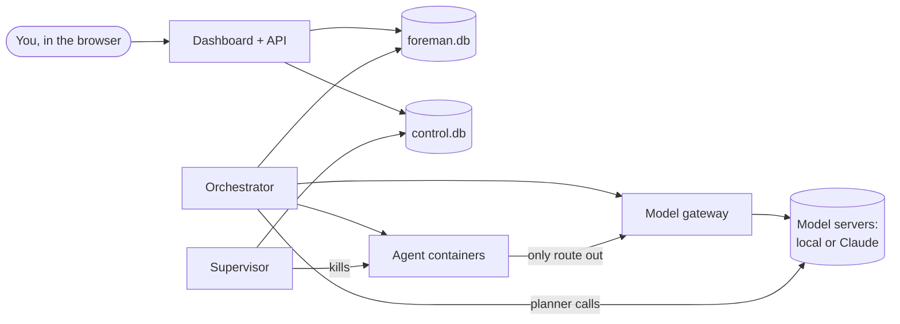

# How Foreman works

This document explains how Foreman is put together and why, in plain language.
For setup and usage see the [README](README.md); for the formal requirements
see [`specs/000-orchestrator/`](specs/000-orchestrator/).

## The big picture

Think of a foreman on a building site. They don't lay bricks. They agree the
plans with the client, break the job into pieces small enough for one worker,
hand each piece out, check the work, adjust the plan as things come up, and
stop everything if something goes wrong.

Foreman does that for software. You agree a specification with a **planner**
model. Foreman breaks the plan into small **tasks**, gives each one to a
**coding agent** in a locked-down container, checks the result, merges it,
and asks a **reviewer** whether the plan still makes sense before moving on.
You watch it all in a web dashboard and can stop anything at any moment.

The models can be local (your Mac Studio, your mini PC) or Claude, and each
role can use a different one.

## The pieces

`foreman up` starts three separate programs. They are separate on purpose:
if one hangs or crashes, the others keep working.

**Dashboard and API.** The web server you talk to. It shows projects, tasks,
live logs and the inbox, and records what you ask for: a new project, a chat
message to the planner, an approval, a Stop. It never runs agents or touches
your repositories itself. Live views update through a stream of events, so
the page refreshes on its own.

**Orchestrator.** The part that does the work. Twice a second it looks
around and acts:

- carries out decisions you made in the inbox;
- starts planner jobs (spec chat, task breakdown, splitting a stuck task,
  reviewing the plan);
- runs the final acceptance check when a project's tasks are all done;
- starts any task that is ready and has a free model slot.

It also runs the **model gateway**, the only way agents can reach a model
(more on that below). It is the only program that writes to your
repositories, so two things can never edit the same clone at once.

**Supervisor.** A small, independent watchdog for the stop buttons. When you
press Stop or E-stop, it kills the affected containers first and writes down
what happened afterwards. Because it doesn't depend on the orchestrator, Stop
works even if the orchestrator is stuck. It also cleans up any container that
no longer belongs to a running task.

## Where things are kept

Everything lives under the data directory (`./data` by default):

| What | Where | Notes |
|---|---|---|
| Projects, tasks, runs, events, checkpoints, nodes | `foreman.db` | SQLite. Every state change is recorded as an event, which is what the activity feeds show. |
| Stop requests and the E-stop flag | `control.db` | Kept apart so a busy or stuck writer on `foreman.db` can never delay a Stop. Only the dashboard writes here; the orchestrator only reads it. |
| "I'm alive" signals | `heartbeats/` | Each program touches a file regularly; the green dots in the top bar come from these. |
| Your repository | `projects/<id>/repo` | Foreman's own clone, on the milestone branch (e.g. `foreman/m1`). |
| One clone per task | `projects/<id>/tasks/<task>` | Each task works on its own branch in its own copy, so a messy attempt never affects anything else. |
| Run logs and prompts | `runs/` | What each agent was given (its "context pack") and everything it printed. |

## A project's life

1. **Specify.** You chat with the planner. It writes `spec.md` (requirements
   with ids like `FR-1.1`), `plan.md`, `validation.md`, acceptance tests and
   the command that runs them. That command is the project's definition of
   done. Each chat turn's changes are committed to the repository, and you
   can edit any document yourself. Approving the spec is always required.
2. **Break down.** The planner splits the plan into tasks. Each task names
   the requirements it covers, the files it may change, the files it should
   read for context, how it will be checked, and which tasks must finish
   first. Foreman measures every task against the coding model's context
   window; tasks that are too big go back to the planner to be split.
3. **Review the plan** (on by default). You see the tasks before anything
   runs, and can edit, remove or approve them.
4. **Execute.** Tasks run one at a time per project, in dependency order.
   Several projects can run side by side on different model servers.
5. **Done.** When every task is done, the acceptance command runs on a fresh
   copy of the milestone branch. If it fails, the reviewer gets the output
   and adds work. If it passes, the project is done and, after your approval,
   the branch is pushed and a GitHub pull request opened.

## One task, step by step

1. **Get ready.** Foreman gives the task its own clone of the milestone
   branch (a retry carries on from the previous attempt's work unless you
   ask for a fresh start) and, if the project has a `.foreman/Dockerfile`,
   makes sure its toolchain image is built.
2. **Build the context pack.** A short briefing for the agent: the slice of
   the spec this task implements, its to-do list, the files it may change
   (in full), the outlines of files it depends on (signatures only, not
   their bodies), how it will be checked and, on a retry, why the last
   attempt failed. The pack must fit the model's context window, which keeps
   small local models from being overwhelmed.
3. **Run the agent.** The coding agent (OpenCode, or optionally Aider) runs
   in a container with the task clone as its working folder. It reads,
   edits and runs commands until it is done.
4. **Commit and fence.** Foreman commits whatever changed, then checks that
   only the allowed files were touched and that the change isn't
   suspiciously large.
5. **Check.** The task's own check runs, then the project's test command, to
   catch anything the change broke elsewhere. Both run inside the sandbox.
6. **Merge.** The task is merged into the milestone branch (or waits for
   your approval if you turned that checkpoint on).
7. **Review.** Before the next task starts, the reviewer looks at the whole
   plan in light of what was just done, and may add, remove or change tasks,
   always with a reason.

If any step fails, the escalation ladder decides what happens next (below).

## Keeping agents in check

Agents are given real freedom inside their box, so the box matters.

**The sandbox.** Each attempt runs in a fresh Docker container, built from
Ubuntu 24.04, as an unprivileged user, with limited CPU and memory. It sees
only two things from your machine: the task's clone (read-write) and its
briefing (read-only). It has no GitHub token and no API keys.

**No way out but the gateway.** Containers sit on an internal Docker network
with no internet, no LAN and no access to your machine. The only thing on
that network is a tiny relay to Foreman's model gateway. A project that
genuinely needs internet in its tasks can switch to an "open" network.
Packages a project needs are installed in its toolchain image, which is
built with network access before any agent runs.

**The model gateway.** Each attempt gets a secret address for its model that
works only for that attempt. The gateway forwards requests to the right model server and, on the
way:

- adds the real API key, so keys never enter a container;
- counts model calls and tokens against the attempt's budget;
- notices when the model keeps giving the same answer (a loop);
- charges paid models to the project and stops at its spend cap;
- refuses everything once the attempt is stopped or finished.

When a limit is hit, the gateway marks the attempt and the orchestrator
kills the container within seconds.

**The watchdog limits** (per attempt, adjustable per project): 60 model
calls, 400,000 tokens, 800 changed lines, 3 identical responses in a row,
and a time limit per task.

**The escalation ladder.** A failed attempt doesn't just stop the project:

1. **Retry** with a fresh agent, told why the last attempt failed (2 retries
   by default). If the same failure keeps repeating, retries are skipped.
2. **Split.** The planner breaks the task into smaller ones.
3. **Escalate** to a stronger model, if you configured one.
4. **Ask you.** The task is blocked and appears in your inbox.

Configuration problems (no model set, a broken toolchain image) skip
straight to step 4, since retrying can't fix them.

**Keeping the plan honest.** The reviewer can change the remaining plan
after every task, but it can't quietly grow it: adding more than 50% to the
approved plan needs your approval, and any change to the spec always does.

## You stay in charge

**The inbox ("Needs you").** Everything waiting for a decision collects in
one place, across all projects, with optional phone notifications through
ntfy. Some checkpoints are always on: approving the spec, spec changes,
plan growth beyond the cap, blocked tasks and a reached spend cap. Others
are per-project choices: reviewing the breakdown (on by default), approving
each plan revision, approving each merge, and approving the final push
(on by default). With only the always-on ones, a project runs from approved
spec to pull request by itself.

When you decide, the dashboard just records the decision; the orchestrator
carries it out on its next pass.

**Stop buttons.**

- **Pause** (task or project): the current step finishes, nothing new
  starts.
- **Stop** (task or project): agents are killed within seconds. Their work
  so far is kept, so you can retry or discard it.
- **E-STOP ALL**: kills everything everywhere and starts nothing until you
  clear it.

Stop also cuts off a planner reply mid-stream.

**Spend caps.** Give a paid node (e.g. Claude) its price per million tokens
and a project a cap. Every paid call is charged to its project. At the cap,
paid calls stop and the inbox asks whether to raise the cap or pause the
project. Local nodes are free and never count.

## Models and nodes

A **node** is a model server: a local OpenAI-compatible server (llama.cpp,
LM Studio, Ollama, MLX, vLLM) or the Claude API. Each project assigns a node
and model to three **roles**:

- **planner**: writes the spec, breaks down the plan, reviews it after each
  task;
- **executor**: the coding agent's model;
- **escalation**: a stronger model for tasks that keep failing (optional).

Each node has a **capacity**: how many task attempts and planner calls it
serves at once. Work waits for a free slot. Foreman checks every node's
health once a minute and gives no new work to one that is down.

The planner is called directly by the orchestrator. Coding agents only ever
reach their model through the gateway, which speaks both the OpenAI chat
format (local servers) and Claude's own format.

## When something goes wrong

If Foreman crashes or the machine restarts, nothing is left half-done. On
start-up the orchestrator:

- marks any attempt that was running as failed, with a reason, and the
  escalation ladder retries it;
- marks interrupted planner calls as failed so you can send the message
  again;
- kills leftover containers and re-runs an interrupted acceptance check;
- repairs each repository clone: aborts a half-finished merge, removes stale
  locks, drops half-written files and returns to the milestone branch.

Each repair is logged in the project's activity feed.

## Where things are in the code

| Area | Code |
|---|---|
| Dashboard (React) | `web/src/` |
| API (FastAPI) | `src/foreman/api/` |
| Orchestrator loop and scheduling | `src/foreman/orchestrator/main.py` |
| One task attempt, start to finish | `src/foreman/orchestrator/runner.py` |
| Planner jobs (chat, breakdown, split, review) | `src/foreman/orchestrator/jobs.py`, `src/foreman/planner.py` |
| Escalation ladder | `src/foreman/orchestrator/escalation.py` |
| Replanning after each task | `src/foreman/orchestrator/replan.py` |
| Acceptance check and pull request | `src/foreman/orchestrator/milestone.py` |
| Carrying out inbox decisions | `src/foreman/orchestrator/gate_actions.py` |
| Supervisor (Stop / E-stop) | `src/foreman/supervisor/main.py` |
| Model gateway | `src/foreman/gateway.py` |
| Containers and the locked-down network | `src/foreman/sandbox.py` |
| Toolchain images | `src/foreman/images.py` |
| Context packs | `src/foreman/core/contextpack.py` |
| Watchdog limits | `src/foreman/core/watchdog.py` |
| Checkpoints and notifications | `src/foreman/core/gates.py` |
| Spend and caps | `src/foreman/core/spend.py` |
| Task states and safe state changes | `src/foreman/core/state.py` |
| Database tables | `src/foreman/core/models.py` |
| Git operations | `src/foreman/gitops.py` |
| Talking to models (planner) | `src/foreman/llm.py` |
| Coding agents | `src/foreman/executors/` |
| Settings (environment variables) | `src/foreman/config.py` |

## Why it's built this way

- **Small tasks, measured.** Local models have small context windows and get
  lost in big jobs. Sizing every task against the model's real window, and
  giving it a focused briefing instead of the whole repository, is what
  makes local models usable.
- **Stop must always work.** Separate programs, a separate stop database, and
  "kill first, write it down after" mean a stuck component can't block the
  big red button.
- **Agents get freedom, not access.** Inside the container an agent can do
  anything; outside it can reach nothing but its model, and never holds a
  key or token.
- **One writer per repository.** Only the orchestrator touches clones, and
  every task works in its own copy, so attempts can't trample each other.
- **Every state change is a careful swap.** A task only moves from the state
  Foreman expects to the next one, so a Stop that lands mid-step is never
  overwritten by a late "success".
- **Plain files and SQLite.** No servers to run besides Foreman itself;
  everything is inspectable with ordinary tools, and the spec lives in your
  repository next to the code.
