#  ai-factory

A self-hosted dashboard that takes a GitHub project through a spec-driven
SDLC with AI agents: interactive specification, then autonomous execution of
small, context-bounded tasks on local (or cloud) models, by five agents with
strictly separate jobs (a Project Planner, a Task Planner, an Environment
Agent, a Tester and a Builder), with an orchestrator that enforces their roles, watches for
runaway agents, replans after each task, and a big red stop button.

Status: **M4 (multi-node & polish) implemented**: all planned milestones are
done (M1 sandboxed execution + stop controls, M2 specify & decompose, M3
autonomy, M4 multi-node scheduling, spend caps, egress lockdown, toolchain
images, portfolio view, Aider), plus strict agent roles: tests first on every
task, test results and coverage per task and project, and web research for
the Project Planner. Runs on **Linux and macOS**; the coding agent is **pi**
by default (OpenCode and Aider are alternatives). Specs, plan and acceptance
criteria live in
[`specs/000-orchestrator/`](specs/000-orchestrator/).

<p>
  <a href="#screenshots">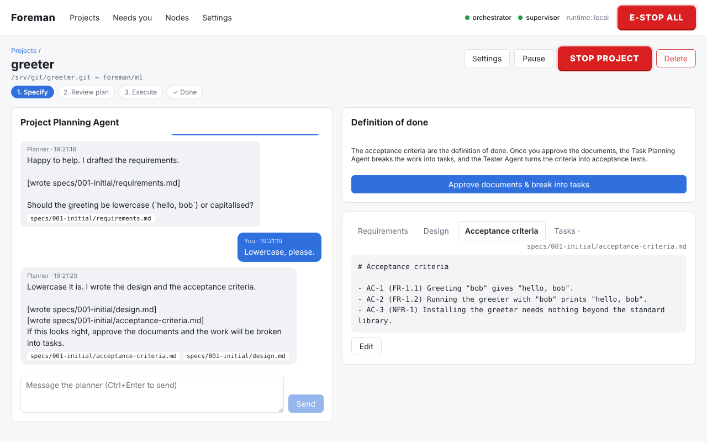</a>
  <a href="#screenshots">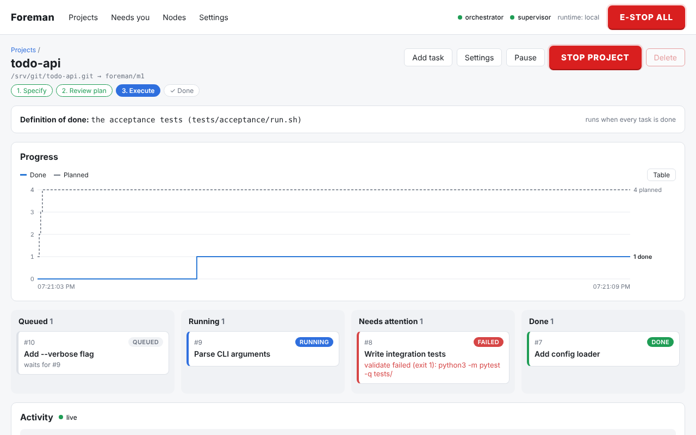</a>
</p>

*Left: writing the planning documents with the Project Planning Agent. Right:
the agents working through the tasks. More in [Screenshots](#screenshots).*

## The agents

| Agent | Does | Can't |
|---|---|---|
| **Project Planning Agent** | Talks with you; reads the repository; writes the requirements, design and acceptance criteria as human-readable markdown; researches unfamiliar topics on the web | Write code, tests, commands or tasks |
| **Task Planning Agent** | Reads the documents and the repository; breaks the work into plain-language tasks (goal, "done when" criteria, dependencies, size); reviews the plan after each task | Write documents, code or tests; name files or commands |
| **Environment Agent** | Once the plan is approved, writes the toolchain image (`.ai-factory/Dockerfile`) and a check script proving every tool the project needs is installed; ai-factory builds and checks it before any task runs | Write code, tests or documents |
| **Tester Agent** | Writes each task's tests before the code exists, the acceptance tests, and the test runner; runs tests | Change anything outside the test folders |
| **Builder Agent** | Writes the code (plus `README.md` and `ARCHITECTURE.md`) until the tests pass; runs the tests | Change any test or the toolchain image |

The orchestrator (plain code, no model) enforces this: planners can only read
(the repository, and the web for the Project Planner) and only their allowed
actions are read from their replies; the Tester and
Builder each see the other's files read-only in their container, and every
change is checked afterwards. Anything refused is logged as a *denied* event.
Each agent can use a different model. See [ARCHITECTURE.md](ARCHITECTURE.md).

## How a project goes

1. **Specify.** Chat with the Project Planning Agent (local model, or
   Claude) about what you want to build. It writes `requirements.md` (ids
   like `FR-1.1`), `design.md` (components and how they interact, in prose)
   and `acceptance-criteria.md`, committing them to your repo under
   `specs/<feature>/`. It thinks in plain language, not code, reads the
   repository (existing code, docs, a schema or reference material you
   add) and searches the web when it needs to. You can edit any document
   directly, and anything you push to the repository's default branch is
   merged into the milestone branch before the planner's next turn.
2. **Approve the documents.** This checkpoint is always on.
3. **Breakdown.** The Task Planning Agent splits the work into
   plain-language tasks: a goal, the requirements covered, up to six "done
   when" criteria, dependencies and a size. Every plan also gets three
   standard tasks: **project setup** (skeleton, test runner,
   first `README.md` and `ARCHITECTURE.md`), **acceptance tests** (the
   definition of done, kept out of the suite each task must pass) and **documentation** (last: `README.md` explains the
   project, how to run it and how to test it; `ARCHITECTURE.md` how it's
   built).
4. **Review the plan** (optional checkpoint, on by default). Edit, drop or
   re-run tasks. `tasks.md` is committed alongside the documents.
5. **Prepare the environment.** The Environment Agent reads the documents
   and the approved tasks and writes `.ai-factory/Dockerfile` (the language,
   test framework, coverage and build tools) plus `.ai-factory/check.sh`.
   ai-factory builds the image on the host, runs the check inside it without
   network, and sends any errors back to the agent (three tries, then it
   asks you: try again with a note, or skip). Only then does any task
   start. Every agent of every task works in that one image, and none of
   them can change it; *Rebuild environment* on the project runs the agent
   again if something turns out to be missing.
6. **Execute, autonomously.** Tasks run one at a time per project (or
   several independent ones at once, a project setting) in Docker
   containers built from `ubuntu:24.04`, using [pi](https://pi.dev) as the
   coding agent (or OpenCode or Aider, per project or task). pi's own prompt
   is about 1.4k tokens against OpenCode's 7.4k, and context packs are sized
   from what is left of the model's window, so pi leaves more room for the
   task on a local model. You never say how a task is tested; each one goes:
   - **Tester:** writes tests from the task's criteria; they must fail
     first. Only test files may change.
   - **Builder:** writes code until those tests and the whole suite pass.
     Tests and the test configuration are read-only to it; tests that
     contradict each other go back to the Tester with its report.
   - **Verify:** the suite runs in the sandbox; every result and the line
     coverage are recorded. If too few of the changed lines are covered
     (default minimum 80%), the task goes back to the Tester once, then asks
     you. The setup task's skeleton only reports coverage.
   - **Merge** into the milestone branch.

   Around that:
   - **Tests and coverage.** The Tester's `tests/run.sh` writes JUnit XML
     and Cobertura or LCOV coverage, formats almost every language's tools
     produce, plus the framework's own HTML report when it has one. The task
     page's Tests tab shows its tests red then green, the coverage of its
     changes and a link to each run's HTML report; the project page shows the
     latest suite, the acceptance tests and coverage over time.
   - **Toolchain.** Containers start from `ai-factory/executor-base` (Ubuntu,
     git, pi and OpenCode, no language runtimes on PATH). The Environment
     Agent's `.ai-factory/Dockerfile` (`FROM ai-factory/executor-base`) is built
     into a per-project image and reused until it changes; agents, tests and
     acceptance checks run in it. Builds can be stopped like any task.
   - **Network.** Executor containers run as an unprivileged user on an
     internal Docker network where the only thing reachable is a relay to
     the gateway: no LAN, no model servers directly, no internet, no host. A
     project whose tests need the network can switch to "open" in its
     settings.
   - **Nodes.** Projects run side by side across your model servers. Each
     node has a capacity shared by task steps and planning calls, and is
     health-checked every minute; work waits for a free slot on a healthy
     node. The Tester and Builder can each have several models, in order of
     preference: each step goes to the first with a free slot. A loaded model
     is preferred over one that must load only when loading it would push out
     a model some project's roles use; otherwise the first choice loads, so an
     idle unload doesn't leave it on the fallback for good. One project can keep
     several machines busy.
   - **Watchdog.** Coding agents reach their model only through ai-factory's
     *model gateway*, which counts calls and tokens against per-step
     budgets, stops an agent that keeps returning the same response, and
     adds the node's API key itself (keys never enter containers). Hitting a
     limit kills the step.
   - **Escalation.** A failed step is retried with a fresh agent session
     (told why the last one failed); if that keeps failing, or the same
     failure repeats, the Task Planner splits the task into smaller ones
     (never setup, acceptance tests or documentation, whose instructions
     depend on what they are); then it moves to an optional stronger *escalation* model; then it is
     blocked and lands in your inbox, where you can also send it back to the
     Tester if the tests look wrong.
   - **Replanning.** After each task, the Task Planner checks the remaining
     plan against the goal and the task's test results and adds, removes or
     changes tasks, each with a reason. Revisions are recorded and
     `tasks.md` is updated. Growth beyond a cap (default +50% of the
     approved plan) waits for your approval. Document changes are only
     proposed; once you approve, the Project Planner makes them.
   - **Back to planning.** To change course yourself, press *Back to
     planning* on the project (once nothing is running). No new tasks start
     while you talk to the Project Planner and edit the documents. When you
     approve them, the Task Planner plans only the remaining work: finished
     tasks are kept and not redone, setup isn't repeated, and the acceptance
     tests are updated only if their criteria changed. Approving the new plan
     discards the old plan's unfinished tasks.
7. **Done.** When every task is done, the acceptance tests run on a fresh
   checkout of the milestone branch. If they fail, the Task Planner gets the
   output and adds work. If they pass, the project is done, and after your
   approval the branch is pushed and a GitHub pull request is opened.

**Needs you.** Everything waiting for a decision (blocked tasks, plan
revisions over the cap, document changes, low coverage, optional merge
approvals, the finished
milestone, a reached spend cap) collects in one inbox, with optional push notifications through
[ntfy](https://ntfy.sh). Which checkpoints are on is a per-project setting;
with only the always-on ones, a project runs from approved documents to pull
request by itself.

Throughout: a live dashboard (task board, streaming planning and agent output,
diffs, run history) and **Pause / Stop / E-stop** at task, project and global
level, enforced by a separate supervisor process that works even if the
orchestrator hangs. Stop also cancels an in-flight planning call. Stopped work
is preserved and can be retried or discarded.

**Spend caps.** Give cloud nodes a price per million tokens and projects a
spend cap. Every paid call (any agent) is charged to its project;
at the cap, paid calls stop and a budget checkpoint asks you to raise the cap
or pause the project. Local nodes are free and never count.

**Portfolio.** The projects page summarises every project (progress, test
coverage, active task, open checkpoints, spend) and the node load; each project shows tasks
done against tasks planned over time, so replanning growth is visible.

**Restarts.** After a crash or restart nothing is left half-done: running
attempts are marked failed (and retried by the escalation ladder),
interrupted merges are aborted, stray processes and acceptance checks are
killed, and the main clone is reset to the milestone branch tip.

You can also skip the spec phase and add tasks by hand ("Skip the spec phase"
when adding a project).

## Screenshots

Captured from the running app (`scripts/screenshots.sh`). The planners here
are a scripted fake model and the tasks use the scripted `shell` executor to
imitate the Tester and Builder, so the scenes are reproducible.

**Specify:** the Project Planning Agent writes the requirements, design and
acceptance criteria with you, in plain language; each turn's file writes are
committed to the repo.


**Review the plan:** the Task Planning Agent's plain-language tasks, with the
standard setup, acceptance-test and documentation tasks, the requirements
each implements, its "done when" criteria and its dependencies.

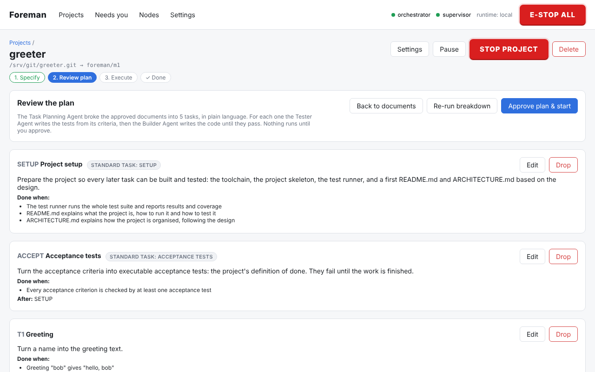

**Needs you:** decisions waiting for you, across all projects.

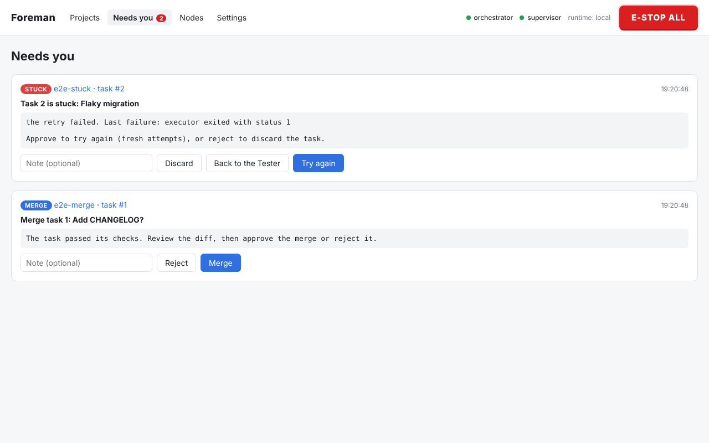

**Watchdog:** per-attempt budgets, escalation level and every step the
ladder took.

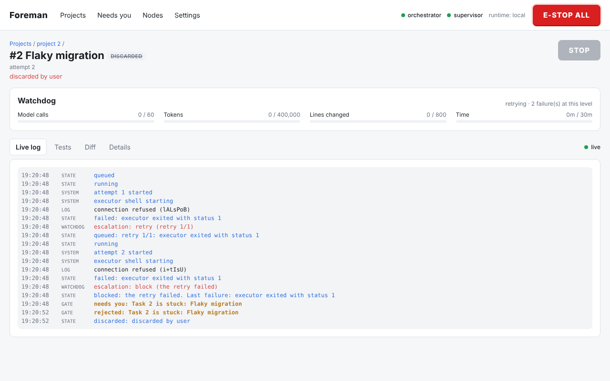

**Project board:** tasks flow from queued to done; dependencies and failure
reasons are shown on each card.


**Live log** of a running task, streamed from its container. This one is
stuck re-running the same failing test...

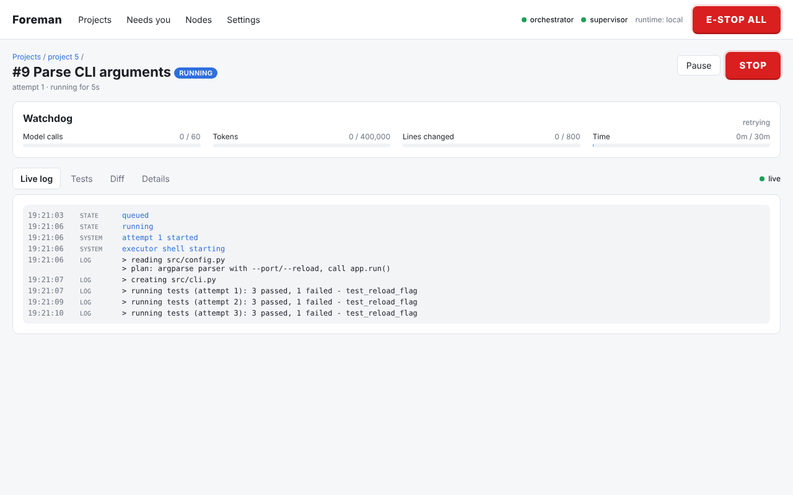

**...so it gets the big red button.** The agent is killed within seconds;
its partial work is kept and can be retried or discarded.

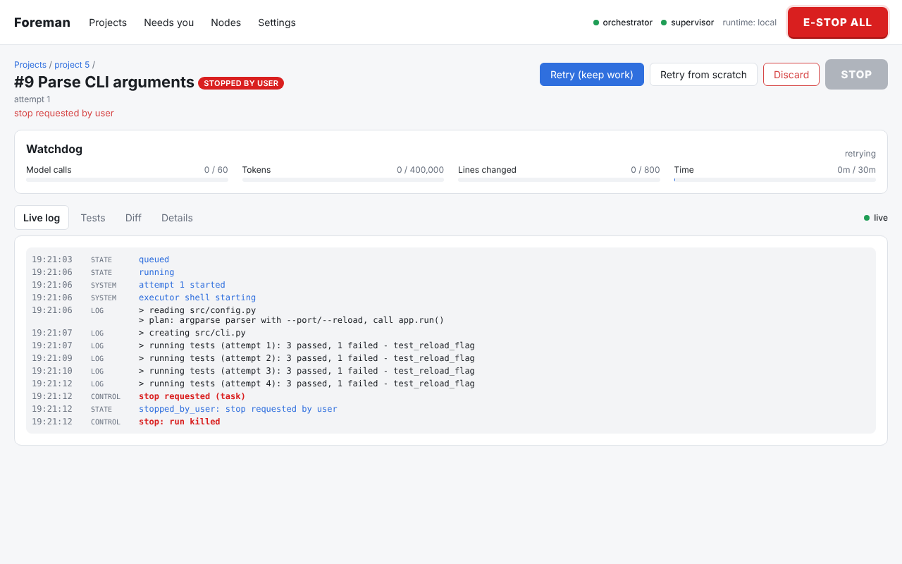

**Diff** of a finished task against the milestone branch.

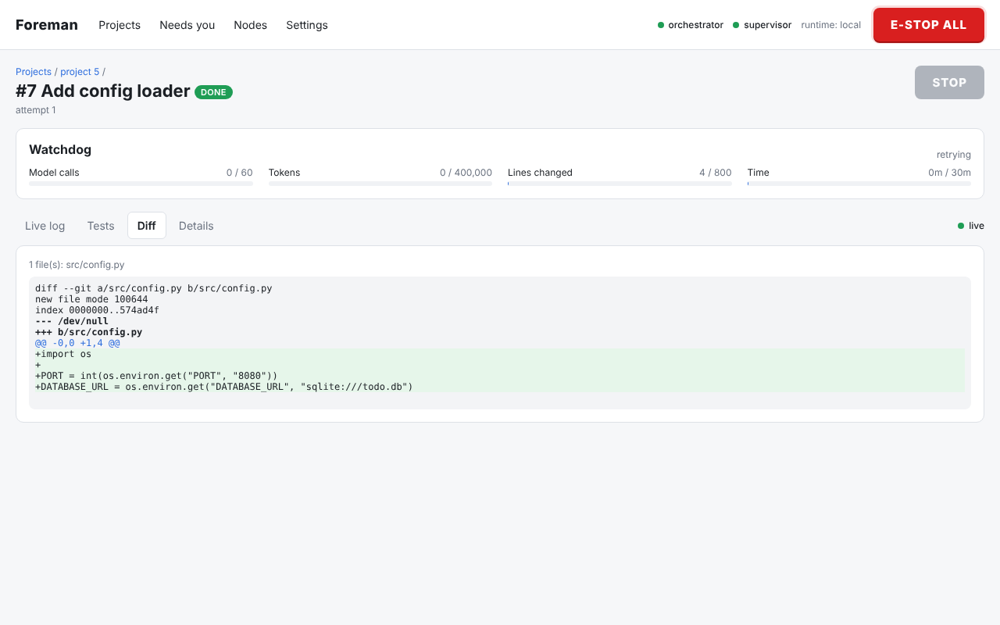

**A task's tests:** the Tester's tests failed first, the Builder made them
pass; coverage of the whole project and of the lines this task changed.

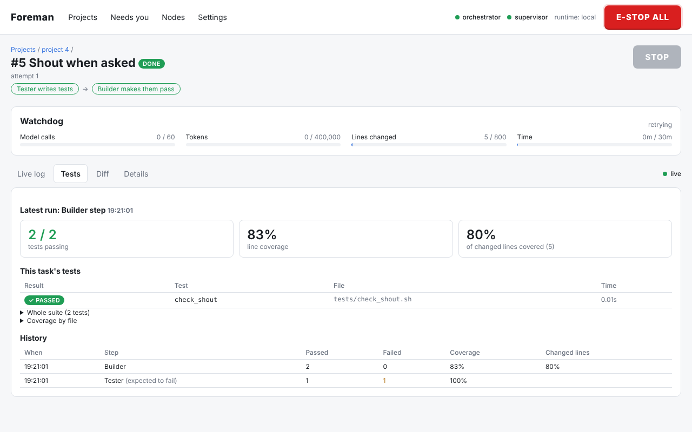

**A project's tests:** the latest suite, coverage after each task, failing
and slowest tests.

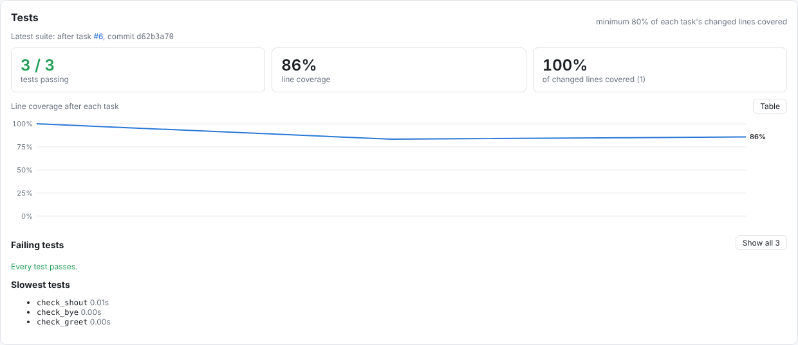

**E-STOP ALL** kills every running agent and blocks new work until cleared.

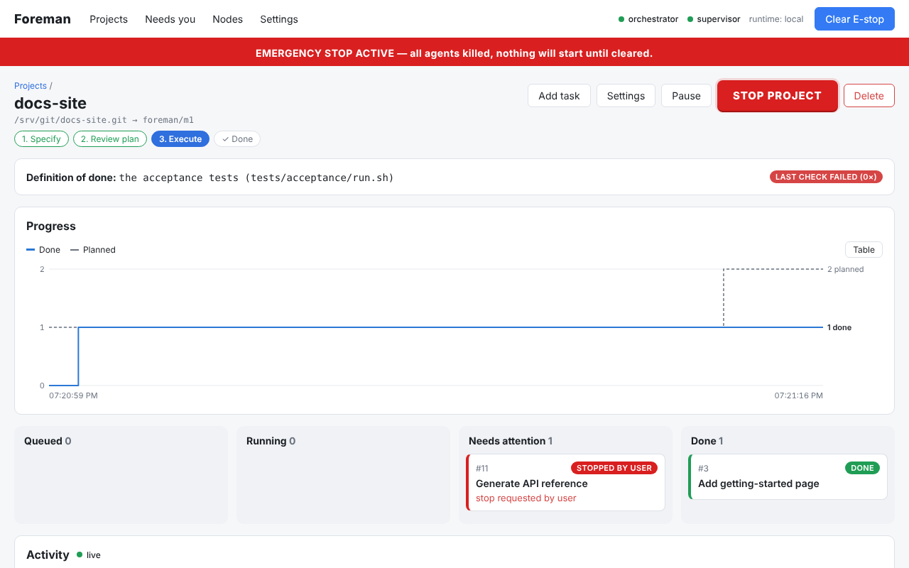

**Projects overview:** what's working, what needs you, node load and spend,
then each project's progress.

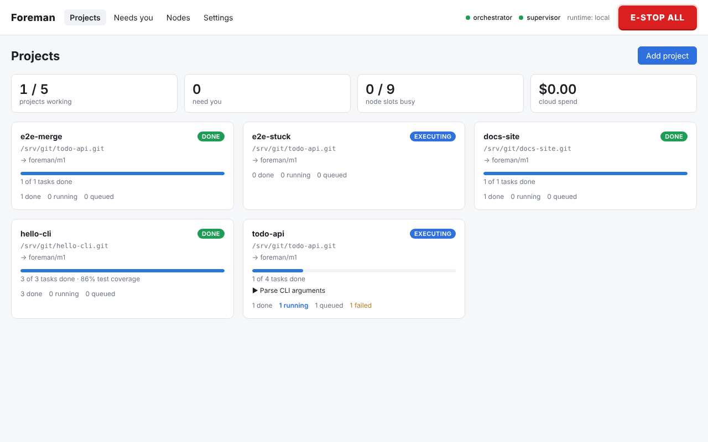

**Progress** of a project: tasks done against tasks planned (hover for
values, or switch to the table).

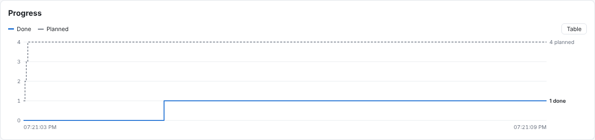

**Nodes:** local model servers and Claude side by side, with health, load,
what's waiting for them and, for paid ones, prices.

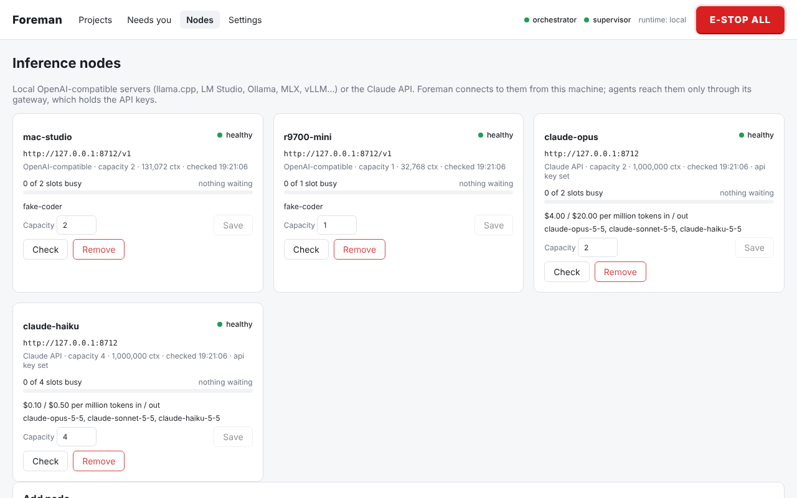

**Project settings:** which model each agent uses and which one takes over
when a step is stuck (local or Claude), how hard the Tester, Builder and
escalation model reason (sent to the model's chat template as
`reasoning_effort`, the way llama.cpp, vLLM and SGLang take it; *default*
leaves the model's own), the coverage minimum and test paths,
plus the sandbox network, spend cap, watchdog limits, autonomy and
checkpoints.

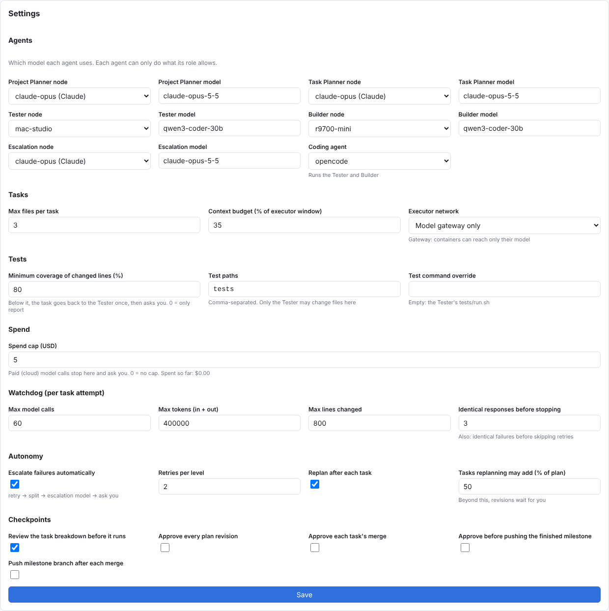

**Agents and what they may do**, shown under the settings.

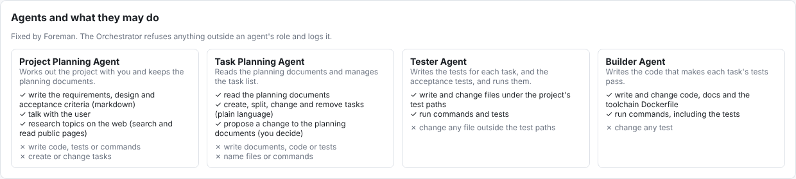

## Quick start

Requirements: Python 3.12+, [uv](https://docs.astral.sh/uv/), Node 20+ (to build
the dashboard), git, and a Docker engine: Docker on Linux, or on macOS the
Lima VM below.

```bash
uv sync                          # Python deps
(cd web && npm ci && npm run build)   # dashboard
uv run ai-factory vm start          # macOS only: the Lima VM containers run in
uv run ai-factory build-image       # ai-factory/executor-base (ubuntu:24.04 + git + pi + opencode)
                                 # add --with-aider to include Aider as well
uv run ai-factory doctor            # checks Docker, the image, mounts and gateway reachability
uv run ai-factory up                # api + orchestrator + supervisor
```

### Hosting on macOS

ai-factory itself runs natively on the Mac; its containers run in a small Linux
VM that ai-factory manages with [Lima](https://lima-vm.io):

```bash
brew install lima
uv run ai-factory vm start          # creates the VM on first use, then starts it
uv run ai-factory vm status         # state, size, mounts
```

The VM uses Apple's virtualization framework with virtiofs, runs rootful
Docker, and can see exactly one host directory: `AI_FACTORY_DATA_DIR`, mounted
writable at the same path. Nothing else from your home directory is visible
to it. ai-factory finds the VM's Docker socket on its own. Size it with
`AI_FACTORY_VM_CPUS` / `AI_FACTORY_VM_MEMORY_GIB` before the first start (the
default leaves most of the machine to your model servers); if you move the
data directory, `ai-factory vm delete` and start again.

Docker Desktop, OrbStack or colima work too: point `DOCKER_HOST` (or
`AI_FACTORY_DOCKER_HOST`) at them, or just leave Docker Desktop's default
context active, and run `ai-factory doctor`.

Open http://127.0.0.1:8700 and add your model servers under **Nodes**:

- Local servers are "OpenAI-compatible", e.g. `http://192.168.1.20:8080/v1`
  for llama.cpp, or `http://127.0.0.1:1234/v1` for a server on the same
  machine (ai-factory's gateway connects to it, not the container). Set the
  context window the model really has: task sizes are computed from it.
  Coding agents get a quarter of it per reply (up to 32k tokens), which a
  thinking model needs to reason and still answer; set **Max output tokens**
  on the node to change that.
- Claude can be added with provider "Anthropic", base URL
  `https://api.anthropic.com` and your API key. Claude can fill any role: the
  planners call it directly (with Claude's web search for research), and coding agents (OpenCode) reach it through
  ai-factory's gateway, which adds the key on the host, so it never enters a
  sandbox. Enter its prices (USD per million input / output tokens) to track
  spend.
- **Capacity** is how many task steps and planning calls a node serves at
  once; editable later on the Nodes page.

Then add a project, choose a model for each agent (node + model), and start
talking to the Project Planning Agent.

### Trying it on Claude first

To see the whole loop before your local models are set up, run every role on
Claude: Opus runs both planners, Sonnet writes the tests and takes
escalations, Haiku writes the code.

```bash
export ANTHROPIC_API_KEY=sk-ant-...
uv run ai-factory claude-nodes                 # nodes claude-opus / -sonnet / -haiku, with prices
uv run ai-factory claude-nodes --project 3     # ...and assign them to project 3's roles
uv run python scripts/claude_smoke.py       # optional: a tiny project, idea to done, $3 cap
```

Give projects a spend cap (Settings → Spend) while you experiment. To move to
local models later, add your local nodes and switch each project's roles in
its Settings; nothing else changes.

### Configuration (environment variables)

| Variable | Default | Meaning |
|---|---|---|
| `AI_FACTORY_DATA_DIR` | `./data` | Databases, project clones, run logs |
| `AI_FACTORY_HOST` / `AI_FACTORY_PORT` | `127.0.0.1` / `8700` | API bind address |
| `AI_FACTORY_TOKEN` | *(empty)* | If set, required as `Authorization: Bearer …` |
| `AI_FACTORY_RUNTIME` | `docker` | `local` runs executors as host processes (tests/dev only, **no isolation**) |
| `AI_FACTORY_DOCKER_HOST` | *(empty)* | Docker socket for every docker command. Empty: `DOCKER_HOST`, else the ai-factory Lima VM if it exists, else the docker CLI's current context |
| `AI_FACTORY_VM_CPUS` / `AI_FACTORY_VM_MEMORY_GIB` | *(derived)* | Size of the Lima VM on macOS, at creation |
| `AI_FACTORY_EXECUTOR_IMAGE` | `ai-factory/executor-base:latest` | Image for executor containers |
| `AI_FACTORY_CONTAINER_CPUS` / `_MEMORY` | `2` / `4g` | Per-container limits |
| `AI_FACTORY_STOP_GRACE_S` | `5` | SIGTERM → SIGKILL grace on Stop |
| `AI_FACTORY_GITHUB_TOKEN` | *(empty)* | Used by the orchestrator to clone/push and to open milestone pull requests; never passed to executors or written to `.git/config`. A token saved under **Settings** in the dashboard takes precedence |
| `AI_FACTORY_NTFY_URL` | *(empty)* | Push notifications for the inbox, e.g. `https://ntfy.sh/my-secret-topic` |
| `AI_FACTORY_PUBLIC_URL` | *(empty)* | Dashboard URL for links in notifications |
| `AI_FACTORY_GATEWAY_HOST` / `_PORT` | `auto` / `8701` | Model gateway. `auto` listens only where containers arrive: the docker bridge address on Linux, loopback on macOS. Every URL also carries a per-run secret |
| `AI_FACTORY_CONTAINER_HOST_IP` | `auto` | What `host.docker.internal` maps to inside containers: `host-gateway`, or Lima's host address (`192.168.5.2`) on Lima |
| `AI_FACTORY_NODE_CHECK_S` | `60` | Seconds between node health checks (`0` disables them) |
| `AI_FACTORY_SWAP_WAIT_S` | `1800` | On [ai-swap](https://github.com/hofftodd/ai-swap) nodes, the longest a task step or planner call waits rather than make a machine swap out a model other running work is using (`0` = no limit) |
| `AI_FACTORY_SEARCH_URL` | *(empty)* | A [SearXNG](https://docs.searxng.org/) instance (JSON API) for the Project Planner's web research on local models. Claude uses its own web search |

## Architecture

A plain-language walkthrough of how it all fits together is in
[ARCHITECTURE.md](ARCHITECTURE.md). In short:

Three OS processes share two SQLite databases:

- **api** (FastAPI): REST + Server-Sent Events + the React dashboard.
- **orchestrator**: schedules ready tasks and runs each one
  (clone → Tester → fence → Builder → fence → test suite + coverage → merge),
  runs planning jobs (chat, breakdown, splits, plan reviews), acceptance checks, and the
  model gateway. It is also the only process that writes to the repositories:
  the API records your decisions on checkpoints and the orchestrator carries
  them out.
- **supervisor**: executes Stop/E-stop. It kills containers/process groups
  first, then records the outcome.

`ai-factory.db` holds projects, tasks, runs and events. `control.db` holds stop
requests and the E-stop flag and is never written by the orchestrator, so a
hung orchestrator holding a write lock cannot block a Stop.

Each task works in its own standalone clone (`data/projects/<id>/tasks/<task>`),
which every attempt first brings up to date with the milestone branch,
mounted at `/workspace` in the container, with the test folders read-only
for the Builder, or everything but the test folders read-only for the
Tester. The rendered prompt and tool config are mounted read-only at
`/ai-factory`, and test results are written to `/ai-factory-results`. Nothing else
from the host is visible.

Executor, validation and acceptance containers join the internal network
`ai-factory-exec-<instance>`; a relay container, `ai-factory-gw-<instance>`, is the
only other member and forwards one port to the model gateway. Toolchain image
builds use the normal build network.

## Development

```bash
uv run pytest -q                 # unit, integration, multi-process stop tests;
                                 # Docker tests run when the image is present
uv run pytest -q --basetemp="$PWD/data/pytest"   # on the Lima VM: test dirs must be
                                 # inside AI_FACTORY_DATA_DIR, the only path the VM sees
uv run ai-factory doctor            # engine, image, mounts, gateway, isolated network
uv run ruff check src tests && uv run mypy src
(cd web && npm run dev)          # dashboard with hot reload, proxies /api to :8700
scripts/e2e.sh                   # full stack + Playwright browser tests
scripts/screenshots.sh           # regenerate docs/screenshots/
python -m tests.fakellm 8999 --demo  # scripted planners + coding model for demos
                                 # (speaks both the OpenAI chat and Claude Messages APIs)
```
