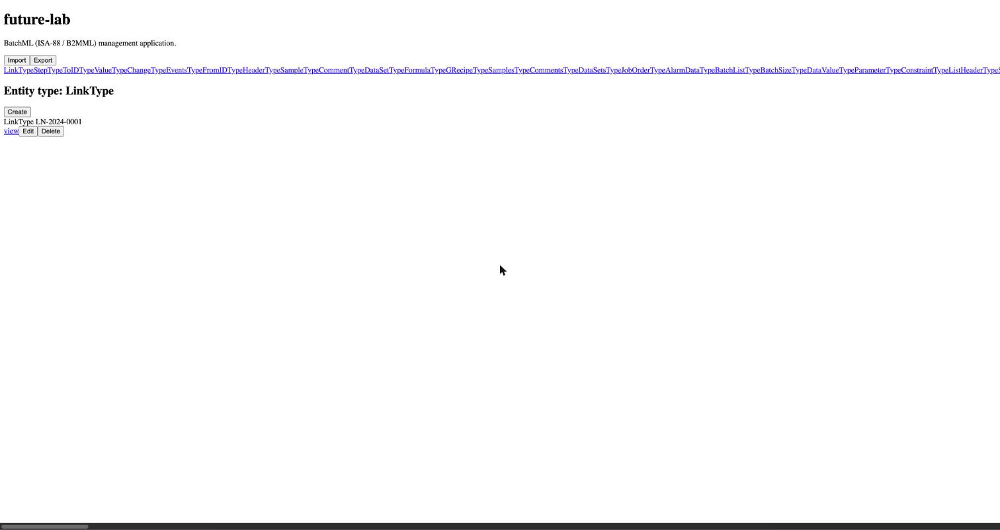
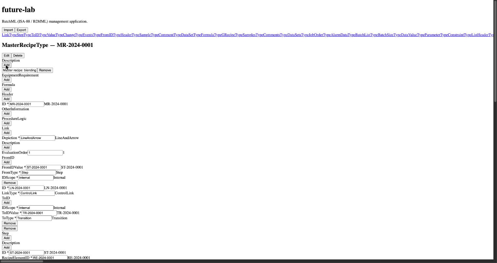
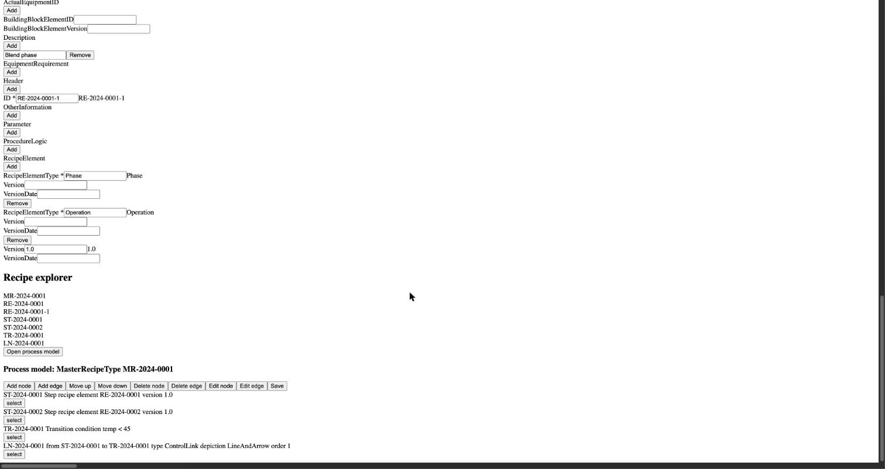

# Evaluation: the future-lab run (November 2026)

The first complete, large run of ai-factory: the project
[future-lab](https://github.com/hofftodd/future-lab), a BatchML (ISA-88 / B2MML)
management application with a FastAPI + PostgreSQL back end, a React front end
and a recipe graph editor.

- **Run:** 2026-11-09 08:42 to 2026-11-12 06:25 (about 45 hours from approved
  plan to PR). It was kept going by hand: 17 ai-factory PRs were merged during
  the run, and 8 more in the hours before it, to fix the factory (see
  [The factory needed 25 PRs to finish the run](#the-factory-needed-25-prs-to-finish-the-run)).
- **Plan:** 29 tasks at approval, about 50 by the end after splits and
  replanning.
- **Output:** about 6.6k lines of application code, about 37k lines of tests
  (296 back-end test functions, plus front-end and acceptance suites).
- **Sources:** future-lab's git history, its code and planning documents, and
  running the app locally with the four sample documents imported. The
  factory's run database was on another host, so this evaluation has no token,
  model or retry counts.

## Summary

The factory is good at producing a back end that passes tests and bad at
producing an app a person can use. Both complaints from trying the app (no
seed data, an unusable UI) come from one gap: **no agent ever runs the app and
looks at it.** The spec never asked for usability or seed data, the Project
Planner never asked about them, and every UI test runs in jsdom against a
mocked `fetch`. The run finished with the acceptance tests passing and opened a
PR for a front end that served a blank page in a real browser. It was fixed by
hand afterwards (future-lab `8a71e64`, "Make the front end run in a browser").

The factory itself also wasn't ready: getting through the run took 25 PRs to
ai-factory, 17 of them merged while the run was in progress.

## What worked

- **The back end holds up.** All 146 tables are generated from the schema.
  All four sample documents imported on the first try and export again
  correctly. Validation, cascading deletes and pagination work.
- **The role separation held.** Every task went Tester first, then Builder.
  No tests were deleted or weakened to make code pass.
- **Splitting, replanning and escalation work.** Over about 45 hours and about
  50 tasks they recovered stuck tasks without a person rewriting them, and the
  run ended with the acceptance tests passing and a PR open. The run was not
  unattended, though: see the next section.
- **The setup was solid.** The Environment Agent's toolchain image built and
  worked, the tests ran in containers, and the README is mostly accurate.

## The factory needed 25 PRs to finish the run

Eight PRs (#5–#12) were merged on 2026-11-08 and the morning of 2026-11-09 to
get the run started. Seventeen more (#13–#29, about 2.8k lines added, 1.4k of
them in `src/`) were merged while it ran, each to get past something that had
stopped or misled it:

| What broke | PRs |
|---|---|
| **Planners:** couldn't read the repository or see files pushed to GitHub; replies claimed to save documents but didn't | #13, #14 |
| **Agent runtime:** long output lines broke reading; agents on large windows ran out of room to answer; the token budget counted every resent prompt; no search tools; no database for test runs; too little time after a timeout | #15, #16, #18, #20, #26 |
| **Role checks, false positives:** test-conflict reports accepted while tests passed; Vitest tests and generated files counted against the wrong role | #17, #21, #22 |
| **Task flow, dead ends:** acceptance-only tasks needed a Builder; merge conflicts had no owner (twice) | #23, #24, #29 |
| **Scheduling and models:** tasks ran strictly one at a time; roles stayed on a fallback model | #19, #25 |
| **Test reports:** HTML reports lost; broken Vitest example in the Tester brief; wrong acceptance-gate text | #27, #28 |

What this means:

- **The run measured the factory as much as the agents.** Many of the stalls
  in the timeline (T31's 16 hours, T34's 5.5) overlap fixes to the factory, so
  the git history can't tell agent failures from factory bugs. The run
  database should record which, for each blocked or retried step.
- **Most of these bugs were in the plumbing around agents, not their roles.**
  Output parsing, budgets, file classification and conflict ownership only
  showed up under a real, large project. The factory's own tests, which run on
  `fakellm`, didn't catch them.
- **The fixes already have regression tests.** 16 of the 17 PRs added or
  changed tests (correction: an earlier version of this evaluation asked for
  them). What was missing is an end-to-end run on real models short of a
  large project.
- **A mid-sized rehearsal project** (a few hours, front end and back end, a
  database) run end to end before each large run would find this class of bug
  cheaply.

## What went wrong in future-lab, and the factory cause behind each

### 1. No step ever ran the real app

The front-end tests, including the acceptance tests, run under Vitest in jsdom
with `fetch` mocked. Nothing ever exercised the front end against the real back
end or in a browser. In a browser, `src/schema.ts` loads the schema with
`node:fs` and the API calls have no route to the back end, so the documented
command served a blank page.

The toolchain has no browser and the project had no `package.json`. The
README's front-end command is
`node /usr/lib/node_modules/vitest/node_modules/vite/bin/vite.js`, which runs
the copy of Vite bundled with Vitest.

**Factory cause:** no gate starts the app. A one-minute check that starts the
app and loads the page in a headless browser would have caught this.

### 2. The UI is unusable

- The front end has no CSS file and no inline styles at all: browser defaults
  only.
- The navigation is all 146 raw schema type names (`LinkType`, `StepType`,
  `ToIDType`…) on one line with no separators. The page scrolls sideways, and
  clicking a type scrolls the content off-screen.
- The app opens on `LinkType`, an arbitrary choice.
- List rows show only the type and ID ("MasterRecipeType MR-2024-0001").
- The "view" page is an editable form with no indentation, so the nesting
  can't be read, and every value appears twice (in the input and as text
  beside it).
- Export makes you type the document ID by hand.

**Factory cause:** the requirements say every type gets a screen generated from
the registry, and nothing about who uses the app or for what. The acceptance
tests check `data-testid`s, never usability. Nothing in the Project Planner's or
Task Planner's instructions mentions users, workflows, navigation or visual
quality, so no agent was ever asked to care.

### 3. The "visual graph editor" isn't a graph

`GraphEditor.tsx` renders two plain lists of divs (nodes, then edges), each
with a "select" button. There's no canvas, no layout and no edges drawn.
"Nodes can be moved" (FR-5.2) became Move up / Move down buttons that reorder
the list.

**Factory cause:** the design named React Flow, but it was never installed and
nothing checks the code against the design. A Builder can pass the tests while
ignoring the design's decisions.

### 4. No seed data

Seed or demo data was never in the spec, and the Project Planner never asked
about it. The four "realistic" sample documents (FR-3.6) total 7 KB. The master
recipe has 2 steps, 1 transition and 1 link, and the general recipe has 2 chart
elements and 1 link. Nothing loads them at startup and there's no seed script,
so a fresh install is empty.

**Factory cause:** seed data isn't a standard task (setup, acceptance tests and
docs are), and "realistic" was never checked.

### 5. Tasks that only exist to satisfy tests

The acceptance tests were written before any UI existed and pinned guessed
`data-testid`s. When they failed, the replanner added tasks to make the app
match them:

- T30: "Ensure the export screen has a single unambiguous export action"
  (exactly one element with the text "Export").
- T32: "Ensure entity list pages render a create button with the expected
  test id".

**Factory cause:** the replanner treats a failing acceptance test as work for
the Builder, even when the test pins an implementation detail rather than
behaviour.

### 6. The code structure drifted, and nothing reviewed it

- Storage, CRUD and import/export all live in `backend/validation.py`
  (1,562 lines), because T6 created that file and later tasks kept adding to it.
- The list endpoint reads the whole table, then filters and paginates in
  Python. It meets the "1,000 rows in a second" criterion but won't scale.
- A list row reports its parent by internal row ID (`1000011`) instead of its
  BatchML ID.
- The import response's identifier list includes Python repr strings such as
  `"[{'FromIDValue': 'ST-2024-0001', ...}]"`.
- About 37k lines of tests against about 6.6k lines of app code (5.5:1).

**Factory cause:** each task only has to pass its tests. No agent looks at the
structure of the code as a whole, and there's no refactoring step.

### 7. Some tasks ate hours

- T31 (list every instance of a type, wherever it's nested) was split three
  levels deep and took about 16 hours, including an overnight stretch with
  only task-list updates.
- T34 (fix CRUD for entities with a BatchML identifier) took about 5.5 hours.
- The spec commit messages contain the Project Planner's chat replies ("You're
  right, my apologies. Here are all three documents…").

## What to improve, in priority order

1. **Add a gate that runs the app for real.** Have the Environment Agent
   produce a start script (like the `tests/services.sh` added during this run)
   and add Playwright with Chromium for projects with a UI. Before any UI task
   merges, and again at the milestone, check that:
   - the app starts;
   - the page loads with no console errors;
   - one real call to the API succeeds;
   - screenshots are saved to the task page.

   UI acceptance tests should run against the real back end, not mocks.
2. **Have the Project Planner ask about users and workflows.** Add questions to
   its instructions: who uses it, the three main workflows, how navigation
   works, which component library, and what demo data is needed. Write the
   answers into the requirements as acceptance criteria phrased as workflows,
   for example "find recipe X and open its graph in three clicks or fewer."
3. **Make seed data a standard task**, alongside setup, acceptance tests and
   docs: a seed command plus loading on startup in development, with enough
   data to exercise the performance criteria. The docs task's "how to run it"
   should end with the app showing data.
4. **Add a review step after each merge.** A read-only reviewer checks the
   change against the design's key decisions (here, React Flow and the layer
   structure) and flags oversized files and bad structure. Schedule a refactor
   task periodically, or when a file passes a size limit.
5. **Review the screenshots.** Use a vision model on the screenshots from
   step 1, or put them in the inbox at the plan checkpoints, so a person sees
   the UI before the milestone ends.
6. **Write acceptance tests about behaviour, not DOM IDs.** When an acceptance
   test pins an implementation detail, the replanner should send the test back
   to the Tester rather than add a task that changes the app to match it.
7. **Make the factory hold up on its own.** Record why each step was blocked
   or retried (agent or factory), and run a mid-sized rehearsal project before
   the next large run. (The 17 fixes already came with unit tests.)
8. **Keep the planner's chat text out of commit messages.** Spec commits should
   say what changed in the documents.

## Follow-up

The recommendations are taken up in six stacked PRs (each builds on the one before):

| PR | Recommendation |
|---|---|
| #30 App check: start the app and look at it in a browser | 1, and part of 6 |
| #31 Users, workflows and demo data in the plan; a demo-data task | 2, 3, 8 |
| #32 Reviewer Agent after each task | 4; screenshots for you (5) come from #30 |
| #33 Replanner fixes tests that pin details, not the code | 6 |
| #34 Run report: where the time went, agent vs factory failures | 7 (causes) |
| #35 Rehearsal project (`scripts/rehearsal.py`) | 7 (rehearsal) |

